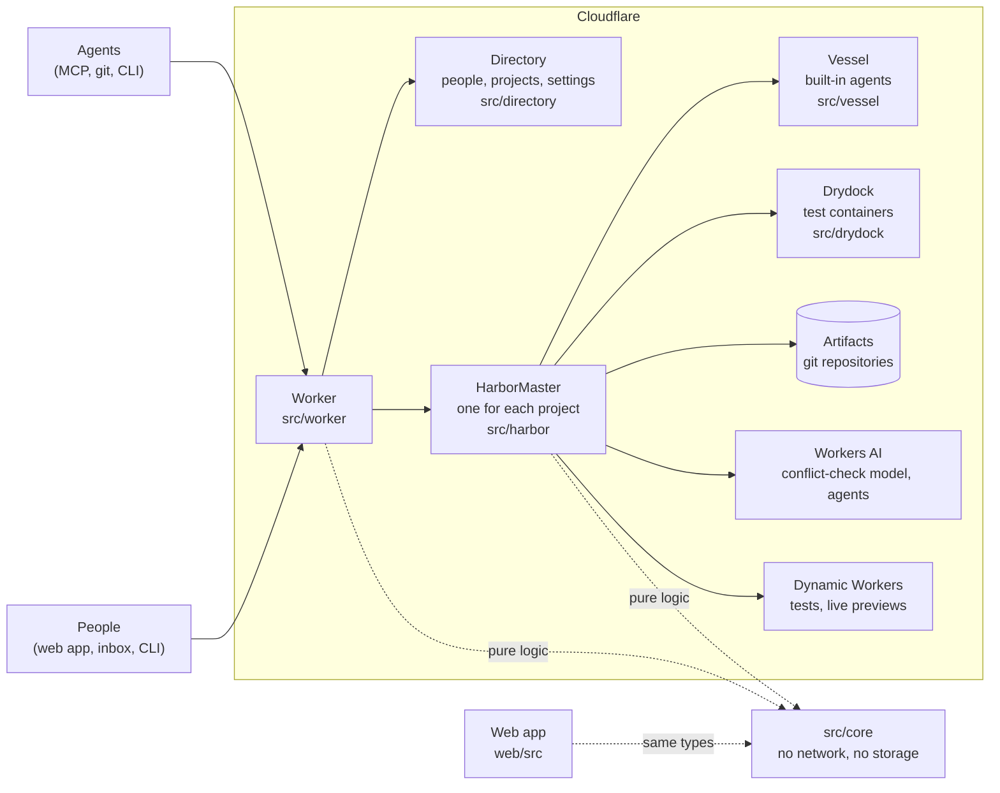
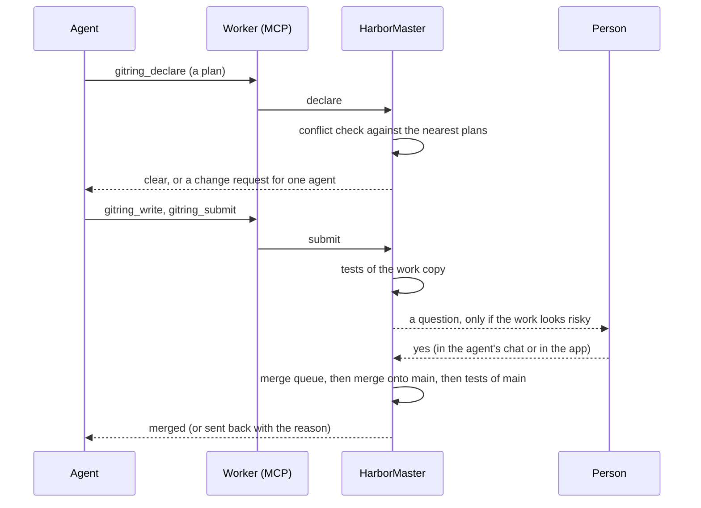

# A map of the code

Start here when you open gitring for the first time. The map has the picture, the path of one merge through the code, the folders, and where to start for each question. Each folder has its own `README.md` with one line for each file. The rules that keep files easy to read are in [CODE-STYLE.md](CODE-STYLE.md). The structure test (`test/structure.test.ts`) checks them.

## The picture

- **Worker.** The front door. It answers MCP, REST, live sockets, previews, hooks and sign-in. It knows who the caller is and which project they mean. It does no merging itself.
- **Directory.** One object for the whole deployment: people, sign-ins, projects, roles, usage.
- **HarborMaster.** One object for each project. It is the only writer of `main`, the conflict-check authority, the merge queue and the source of live events. This is the heart.
- **Core.** Pure logic that takes data in and gives data out: reading code, the distance between plans, the rules, the merge ladder. It is why tests need no network.

## One merge, step by step

| Step | Where it is in the code |
|---|---|
| The tools an agent calls | `src/worker/mcp.ts`, `mcp-projects.ts`, `mcp-history.ts` (tool list), `mcp-kit.ts` (shared parts) |
| Declare, write, read, confirm | `src/harbor/master/protocol.ts` |
| The conflict check | `src/harbor/master/course-check.ts` runs it; `src/core/analysis/` and `src/core/coord/` hold the logic |
| Change requests | `src/harbor/master/corrections.ts`, `src/core/coord/corrections.ts` |
| Tests of a work copy | `src/harbor/master/checks.ts`, `src/platform/checks/` |
| When a person must say yes | `src/core/approvals.ts` (the rules), `src/harbor/master/approvals.ts` and `decisions.ts` (the questions and answers) |
| The merge queue and the merge | `src/harbor/master/queue.ts`, `merge.ts`, `trains.ts`; the merge ladder is in `src/core/land/` |
| The record of why | `src/harbor/master/merge-record.ts`, `src/core/logbook.ts` (called the merge record in the app) |
| Tests of main, and revert | `src/harbor/master/main-tests.ts` |
| Git storage | `src/platform/repo/` (the `RepoBackend` interface, Artifacts, push, packs) |

## The folders

| Folder | What is in it |
|---|---|
| `src/core/` | Pure logic. Start with its README: it explains the conflict check in plain words. |
| `src/harbor/` | The project coordinator. `harbor.ts` is the front door; `master/` has one file for each job. |
| `src/worker/` | The Worker: `app.ts` builds the routes, `routes/` has the REST routes, `github-tools/` the GitHub-compatible tools, `mcp*.ts` the MCP servers. |
| `src/directory/` | The Directory object, sign-in with passkeys and the OAuth server for MCP clients. |
| `src/vessel/` | The runner of the built-in agents. |
| `src/drydock/` | The object that starts one container for the tests of a work copy. |
| `src/platform/` | Contact with the outside: git storage, GitHub (optional), test running and previews, AI models. |
| `web/src/` | The web app. `views/` has one page for each screen, `app/` the shell, `chart/` the map, `design/` the design system. |
| `cli/` | The `gitring` command: `commands/` has one file for each command, `lib/` the shared parts. |
| `scripts/` | Scripts for people: the scripted agents (`meet`), the smoke test, the load test, setup, and the screenshot tool of the design agent (`shots`). |
| `test/` | The tests, in the same shape as the code. `test/structure.test.ts` keeps the files readable. |
| `docs/` | This map, the style rules, self-hosting, the judges' map, and the design agent's knowledge in `design/`. |
| `plugins/` | The Claude Code plugin for gitring. |
| `examples/`, `bench/`, `local/` | An example project, the coordination benchmark, and the local run without a Cloudflare account. |

## Where to start

| You want to know | Open |
|---|---|
| How two plans are compared | `src/core/README.md`, then `src/core/analysis/range.ts` and `src/core/coord/rules.ts` |
| What the agent tools do | `src/worker/mcp.ts` |
| How a project is made (and how GitHub is only one source) | `src/worker/mcp-projects.ts`, `src/core/templates.ts`, `src/harbor/master/import.ts` |
| Why a merge waits for a person | `src/core/approvals.ts` |
| How `main` stays correct | `src/harbor/master/merge.ts`, `main-tests.ts` |
| Why a line is in the code | `src/core/history.ts`, `src/harbor/derived/` |
| How people sign in | `src/directory/passkeys.ts`, `src/worker/passkey-routes.ts` |
| What a screen does | `web/src/views/<Name>View.tsx` and the folder next to it |
| How the app looks and why | `docs/design/INTENT.md` |

## Where to change things

- **Add an MCP tool.** Define it in `src/worker/mcp.ts` (or `mcp-projects.ts`, `mcp-history.ts`), add the method it calls to the layer of `src/harbor/master/` that has its job, and add its name to the tool list test in `test/mcp/`.
- **Add a REST route.** Put it in the file of its area in `src/worker/routes/`. The order of the mounts in `src/worker/app.ts` is the order of the routes.
- **Add a setting.** The type is in `src/core/types/settings.ts` and its default in `settings-defaults.ts`. The project coordinator reads and checks it in `src/harbor/master/settings.ts`. The page is a section in `web/src/views/settings/`.
- **Add a page.** Make `web/src/views/<Name>View.tsx`, add its route in `web/src/app/router.tsx` and its lazy load in `web/src/app/views.ts`. Add a tab in `web/src/app/TopBar.tsx` only if it is a main screen.
- **Change the conflict check.** Rules are in `src/core/coord/rules.ts` and policy in `src/core/coord/policy.ts`. Run `npm run bench` to see the effect on many simulated plans.

## Names

The stored data and the API use older names than the screens. The table of code names and plain names is in [CODE-STYLE.md](CODE-STYLE.md): intent is a task, attempt is a work copy, course is a plan, correction is a change request, landing is a merge, logbook is the merge record. A comment, a screen and a document use the plain name.
